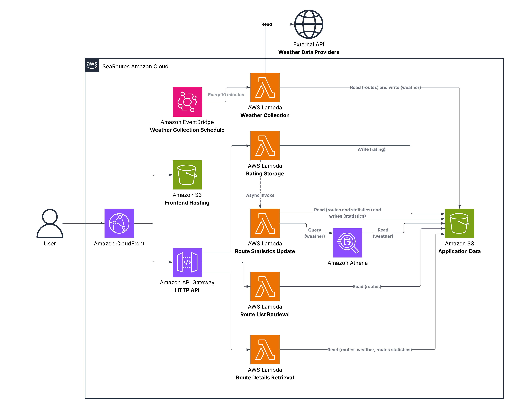

# Windsurf Data Collector

## AWS Diagram



## S3 Storage Structure Diagram

```
Amazon S3
└── SeaRoutes Data
    │
    ├── routes/
    │   ├── route_id_1.json # Route id becomes a name for a file
    │   ├── route_id_2.json
    │   └── route_id_3.json
    │
    ├── ratings/
    │   ├── route_id_1/
    │   │   ├── rating_id_1.json # Rating id becomes a name for a file
    │   │   └── rating_id_2.json
    │   └── route_id_2/
    │       └── rating_id_3.json
    │
    ├── route_statistics/
    │   ├── route_id_1.json
    │   └── route_id_2.json
    │
    └── weather/
        └── year=2026/
            └── month=10/
                └── day=14/
                    ├── 12-00.json
                    ├── 12-10.json
                    └── 12-20.json
```

## Data Models

### In S3

`S3: routes/route_id_1.json`
```json
{
  "route_id": "route_id_1",
  "name": "Hietaniemi",
  "coordinates": [
    [60.175, 24.912],
    [60.170, 24.895],
    [60.162, 24.880]
  ]
}
```

`S3: ratings/route_id_1/rating_id_1.json`
```json
{
  "rating_id": "rating_id_1",
  "route_id": "route_id_1",
  "start_time": "2026-10-13T12:00:00Z",
  "end_time": "2026-10-13T14:00:00Z",
  "rating": 5
}
```

`S3: weather/year=2026/month=10/day=14/12-00.json`
```json
[
  {
    "timestamp": "2026-10-14T12:00:00Z",
    "latitude": 60.175,
    "longitude": 24.912,
    "wind_speed": 7.2,
    "wind_direction": 220,
    "wave_height": 0.5,
    "water_temperature": 12,
    "air_temperature": 14,
    "cloud_cover": 60
  },
  {
    "timestamp": "2026-10-14T12:00:00Z",
    "latitude": 60.170,
    "longitude": 24.895,
    "wind_speed": 6.5,
    "wind_direction": 215,
    "wave_height": 0.4,
    "water_temperature": 12,
    "air_temperature": 14,
    "cloud_cover": 55
  },
  {
    "timestamp": "2026-10-14T12:00:00Z",
    "latitude": 60.162,
    "longitude": 24.880,
    "wind_speed": 8.1,
    "wind_direction": 230,
    "wave_height": 0.7,
    "water_temperature": 11,
    "air_temperature": 13,
    "cloud_cover": 65
  }
]
```

`S3: route_statistics/route_id_1.json`
```json
{
  "route_id": "route_id_1",
  "overall_rating": 4.3,
  "total_ratings": 42,
  "ratings_across_conditions": [
    {
      "start_time": "2026-10-13T12:00:00Z",
      "end_time": "2026-10-13T14:00:00Z",
      "weather": {
        "wind_speed": 7.2,
        "wind_direction": 220,
        "wave_height": 0.5,
        "water_temperature": 12,
        "air_temperature": 14,
        "cloud_cover": 60
      },
      "average_rating": 4.8,
      "total_ratings": 12
    },
    {
      "start_time": "2026-10-12T09:00:00Z",
      "end_time": "2026-10-12T11:00:00Z",
      "weather": {
        "wind_speed": 3.1,
        "wind_direction": 180,
        "wave_height": 0.2,
        "water_temperature": 11,
        "air_temperature": 10,
        "cloud_cover": 90
      },
      "average_rating": 3.2,
      "total_ratings": 8
    }
  ]
}
```

### For HTTP responses

`HTTP response: GET /routes`
```json
[
  {
    "route_id": "route_id_1",
    "name": "Hietaniemi",
    "coordinates": [
      [60.175, 24.912],
      [60.170, 24.895],
      [60.162, 24.880]
    ]
  },
  {
    "route_id": "route_id_2",
    "name": "Lauttasaari",
    "coordinates": [
      [60.158, 24.882],
      [60.151, 24.874],
      [60.147, 24.865]
    ]
  }
]
```

`HTTP response: GET /routes/route_id_1`
```json
{
  "route_id": "route_id_1",
  "name": "Hietaniemi",
  "coordinates": [
    [60.175, 24.912],
    [60.170, 24.895],
    [60.162, 24.880]
  ],
  "overall_rating": 4.3,
  "total_ratings": 42,
  "ratings_across_conditions": [
    {
      "start_time": "2026-10-13T12:00:00Z",
      "end_time": "2026-10-13T14:00:00Z",
      "weather": {
        "wind_speed": 7.2,
        "wind_direction": 220,
        "wave_height": 0.5,
        "water_temperature": 12,
        "air_temperature": 14,
        "cloud_cover": 60
      },
      "average_rating": 4.8,
      "total_ratings": 12
    },
    {
      "start_time": "2026-10-12T09:00:00Z",
      "end_time": "2026-10-12T11:00:00Z",
      "weather": {
        "wind_speed": 3.1,
        "wind_direction": 180,
        "wave_height": 0.2,
        "water_temperature": 11,
        "air_temperature": 10,
        "cloud_cover": 90
      },
      "average_rating": 3.2,
      "total_ratings": 8
    }
  ],
  "current_weather": {
    "wind_speed": 7.27,
    "wind_direction": 222,
    "wave_height": 0.53,
    "water_temperature": 11.67,
    "air_temperature": 13.67,
    "cloud_cover": 60
  },
  "suitability": "Good"
}
```

## Repo Structure Diagram

```
SeaRoutes/
│
├── frontend/
│   ├── index.html                         # Main page
│   ├── app.js                             # Displays routes, weather and ratings, sends API requests
│   └── style.css                          # Styles
│
├── backend/
│   │
│   ├── weather_collection/                # Lambda 1: Weather Collection
│   │   ├── collect_weather.py             # Gets routes coordinates and requests weather data for them from external APIs
│   │   └── save_weather.py                # Formats weather data and saves it to S3
│   │
│   ├── ratings/                           # Lambda 2: Rating Storage
│   │   └── save_rating.py                 # Saves a user rating to S3 and asynchronously invokes the statistics Lambda
│   │
│   ├── route_statistics/                  # Lambda 3: Route Statistics Update
│   │   ├── update_route_statistics.py     # Calculates aggregated route statistics based on user ratings and historical weather data, then saves them to S3
│   │   └── query_weather_history.py       # Queries historical weather data from S3 using Amazon Athena
│   │
│   ├── routes/                            # Lambda 4: Route List Retrieval
│   │   └── get_routes.py                  # Reads all predefined routes from S3
│   │
│   └── route_details/                     # Lambda 5: Route Details Retrieval
│       ├── get_route.py                   # Reads route, weather and statistics data and returns route details
│       ├── get_current_weather.py         # Reads the latest weather data from S3, finds the weather at each point of the selected route, and calculates average weather conditions for the whole route
│       └── calculate_conditions_suitability.py # Compares current weather with past ratings and calculates suitability
│
├── sql/
│   └── create_weather_table.sql           # Defines the Amazon Athena table for historical weather queries
│
├── tests/
│   ├── test_collect_weather.py
│   ├── test_save_weather.py
│   ├── test_save_rating.py
│   ├── test_update_route_statistics.py
│   ├── test_query_weather_history.py
│   ├── test_get_routes.py
│   ├── test_get_route.py
│   ├── test_get_current_weather.py
│   └── test_calculate_conditions_suitability.py
│
├── requirements.txt                       # Python dependencies
└── README.md
```
